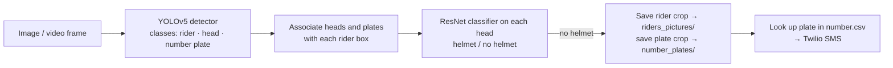

# Automatic Helmetless Rider Detection and Penalty Notification

A computer-vision application that finds motorcycle riders **without a helmet** in images or video, saves the rider
crop and the **licence-plate** crop, and can send an **SMS notice** to the phone number registered for that plate.

## How it works



- **Detector:** YOLOv5 (small) trained to detect `rider`, `head` and `number` (plate) — `rider_helmet_number_small.pt`.
  The `models/` and `utils/` folders are vendored from the Ultralytics YOLOv5 repository (GPL-3.0).
- **Helmet classifier:** a torchvision ResNet fine-tuned for helmet / no-helmet on head crops —
  `helment_no_helmet98.6.pth`. The number in the file name is from training and has not been re-measured here.
- **Decision rule:** a head is classified only if it is at least 46 px tall and the classifier's top-two score margin
  exceeds `head_classification_threshold` (3.0); detector confidence 0.35, NMS IoU 0.30 (`my_functions.py`).
- **GUI:** Tkinter desktop app (`main.py`) with buttons to open a file, view rider crops, view plates and send SMS.

## Setup

```bash
python -m venv .venv && source .venv/bin/activate   # Windows: .venv\Scripts\activate
pip install -r requirements.txt
cp number.example.csv number.csv                    # plate -> phone registry (kept out of Git)
```

For SMS, set `TWILIO_ACCOUNT_SID`, `TWILIO_AUTH_TOKEN` and `TWILIO_FROM_NUMBER` in your environment
(template: `.env.example`). Without them the app still detects and saves crops; only "send message" is disabled.

## Run

```bash
python main.py              # desktop GUI: choose a .mp4/.MOV/.mkv video or a .jpg/.png image
python detect_video_cli.py  # no GUI: runs on test_video.MOV and writes output.avi
```

Outputs: `riders_pictures/` (riders without helmets), `number_plates/` (plate crops), `output.avi` (annotated video).

## Verified in this cleanup

- Both checkpoints load with PyTorch 2.x (YOLO classes: rider, head, number; classifier: ResNet).
- Detection runs headless on frames of `test_video.MOV`.
- The GUI and SMS path were not run (no display / credentials in the test environment).

No accuracy, precision or recall figures are reported because no labelled evaluation set is included.

## Limitations

- **The SMS step is a demo shortcut, not plate recognition.** There is no OCR stage. `object_detection2` appends the
  plate detector's *confidence score* (e.g. `0.36`) to `number.txt`, and `number.csv` rows are matched on their first
  token (`0.36 KA-01-AB 1234,<phone>`). Real use needs a plate-OCR step (e.g. EasyOCR or PaddleOCR) that writes the
  plate text instead.
- Thresholds were tuned by hand on sample footage; performance at night, in rain or with occlusion is untested.
- Model files are large (92 MB classifier, 14 MB detector) — consider GitHub Releases or Git LFS.
- Real number plates and phone numbers are personal data; keep real registries and captured images out of Git.

## Repository structure

```
main.py                 Tkinter GUI application
detect_video_cli.py     command-line video run (no GUI, no SMS)
my_functions.py         model loading, detection, head classification
models/, utils/         vendored YOLOv5 code
images/                 GUI button artwork
number.example.csv      template for the plate -> phone registry
test_video.MOV          sample input video
```

## References

- G. Jocher et al., Ultralytics YOLOv5, <https://github.com/ultralytics/yolov5>.
- K. He et al., "Deep Residual Learning for Image Recognition," *CVPR*, 2016.
